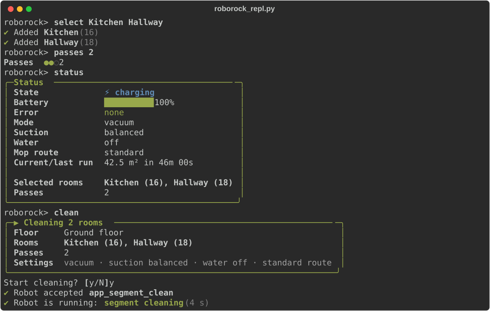
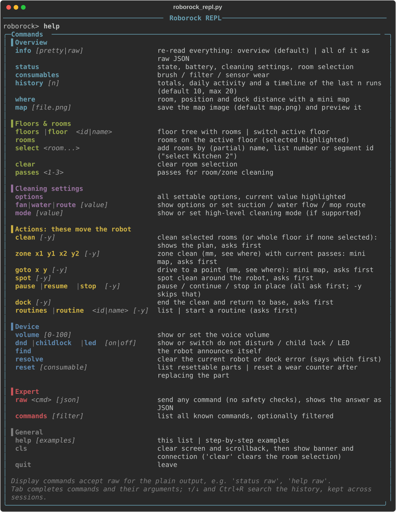

# Roborock Python REPL

Interactive command line for controlling and inspecting Roborock V1 vacuums (tested on an S7, `roborock.vacuum.a15`) through the Roborock cloud account.

> **Disclaimer:** This is an unofficial hobby project. It is not affiliated with, endorsed by or supported by Roborock. "Roborock" is a trademark of its owner. Use at your own risk: it sends real commands to your robot.



## Setup

```
python3 -m venv .venv
.venv/bin/pip install -r requirements.txt
./roborock_repl.py --email you@example.com
```

The first run sends a login code to your email. The session is then stored in `~/.roborock-repl/` and reused, so later runs don't request a new code. Use `--relogin` to force a new code and `--show-secrets` to print the device's `local_key` unmasked.

When a login is saved you can set a passphrase (4+ characters, Enter skips). It encrypts `session.json` (the cloud login token) and `cache.pkl` (the robot's `local_key` and maps) with scrypt + AES-GCM, and every start asks for it. To add or change one, or if you forget it, run `--relogin`. Limits: a short passphrase can still be guessed offline by someone who has the files, `history` is not encrypted, and the key stays in memory while the REPL runs.

## Usage

Type `help` at the `roborock>` prompt for the full list. Tab completion and history are available. The main commands are:

- **State:** `info`, `status`, `where`, `map`, `consumables`, `history`
- **Cleaning:** `rooms`, `select`, `clean`, `zone`, `goto`, `spot`, `pause`, `resume`, `stop`, `dock`
- **Settings:** `fan`, `water`, `route`, `mode`, `passes`, `volume`, `dnd`, `childlock`, `led`
- **Floors and routines:** `floors`, `floor`, `routines`, `routine`
- **Low level:** `raw`, `commands`

Commands that move the robot ask for confirmation first. Add `-y` to skip the prompt.

After the computer sleeps or the connection drops, the next command checks the connection and reconnects if needed.
If it fails, commands that only read are tried once more. Commands that act on the robot are never resent: the REPL
tells you whether the robot received the command. `reconnect` does the same on demand. The prompt changes to
`roborock (offline)>` while the robot can't be reached. Ctrl+C cancels a running command; at the prompt it quits.

<details>
<summary>Full command list (<code>help</code>)</summary>



</details>

`map` saves a PNG of your floor plan. `*.png` is ignored by git so the image isn't committed by accident.

## Acknowledgement

This script is only a thin interface on top of [python-roborock](https://github.com/Python-roborock/python-roborock), and it would not work without that library. The library does all the real work: cloud login, device discovery, the MQTT/local protocol and map parsing. The cache workaround in `roborock_repl.py` depends on python-roborock 7.x internals, so keep the version pinned in `requirements.txt`.

The screenshots use sample data and are generated with `docs/make_screenshots.py`.

## License

MIT, see [LICENSE](LICENSE).
